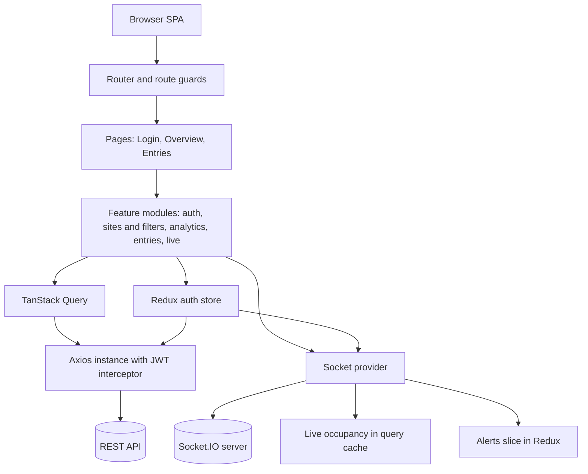
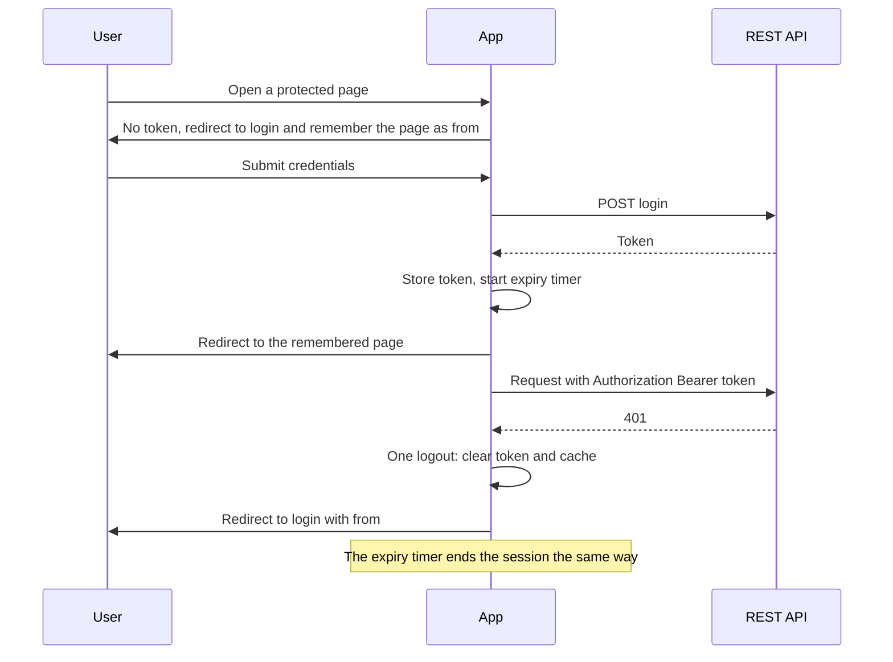
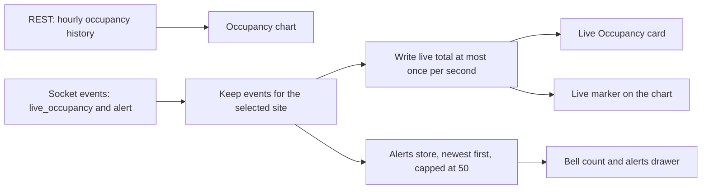

# Crowd Management System

A dashboard for watching how busy a set of sites is. It shows live occupancy, footfall and dwell time with comparisons against the previous period, a demographics breakdown, a paginated table of every entry and exit, and a stream of alerts that arrives over Socket.IO.

Live demo: LIVE_URL_HERE

| Login | Overview |
| --- | --- |
|  |  |

| Crowd entries | Alerts drawer |
| --- | --- |
|  |  |

## What the assignment asked for and how I read it

The scope was a login page, an overview dashboard, a crowd entries table and live alerts and occupancy through Socket.IO, all against an existing backend.

A few requirements are easy to skim past, so I wrote down how I understood them:

- The dashboard follows the API contract only. Every number on it comes from a response; nothing is computed from made-up data.
- Live data must not be polled. The REST endpoints return history, and the socket carries what is happening now.
- Every page except the login is protected, and every request except the login carries the JWT.
- The stat cards show a comparison against the previous period ("more than yesterday"), so each card needs a second request for the previous range.
- A visitor who is still inside has no exit time and no dwell time. The table shows a marker for that, not a zero.
- Pagination has to be driven by the server. The API reports `totalRecords` and `totalPages`, and the client asks for one page at a time.

## Tech stack and why

| Area | Choice | Why |
| --- | --- | --- |
| UI | React 19, TypeScript (strict), Vite | Fast feedback while building, and strict types catch API shape mistakes early. |
| Styling | Tailwind CSS v4, shadcn/ui on Radix | Radix gives me focus handling, dialogs and selects that already behave correctly with a keyboard and a screen reader. I own the component code, so changing it is cheap. |
| Routing | React Router 8 | Lazy routes and URL search params, which I use as the source of truth for filters. |
| Server state | TanStack Query | Caching, de-duplicated requests, retry rules and `keepPreviousData` for pagination. |
| Auth state | Redux Toolkit, auth only | The session is the one piece of global client state that several unrelated parts read. API data is deliberately kept out of Redux; see the decisions section. |
| HTTP | Axios with interceptors | One place to attach the token and one place to react to a 401. |
| Live data | socket.io-client | The backend speaks Socket.IO. |
| Charts | Recharts through the shadcn chart wrapper | Gives me theme tokens and tooltip styling without writing SVG by hand. |
| Forms and validation | react-hook-form, zod | zod validates the login form and every API response. |
| Dates | `@date-fns/tz` and `Intl` | Time zone aware day boundaries, and display formatting without pulling in a formatter library. |
| Smaller pieces | sonner (toasts), lucide-react (icons), jwt-decode | Toasts, icons and reading the token expiry. |

## Getting started

Node 24 was used for development. I did not pin an `engines` field, so any current LTS should work.

```bash
npm install
cp .env.example .env
npm run dev
```

Sign in with the credentials provided by the hiring team.

| Script | What it does |
| --- | --- |
| `npm run dev` | Vite dev server on port 5173 |
| `npm run build` | Type-check with `tsc -b`, then production build |
| `npm run preview` | Serve the production build locally |
| `npm run lint` | ESLint |
| `npm run format` | Prettier |

Environment variables:

```bash
VITE_API_BASE_URL=   # required, base URL of the REST API
VITE_SOCKET_URL=     # optional, defaults to VITE_API_BASE_URL
```

`.npmrc` sets `legacy-peer-deps=true`. `@hookform/resolvers` declares a peer range that conflicts with the zod version I use, and the install fails without the flag. The setting is committed so a deploy does not hit the same error.

## Architecture

### System overview



### Auth flow



### Live data



Nothing in the app polls. History comes from REST once per filter change, and everything live comes from the socket.

### Folder structure

```
src/
  app/          providers, store, router, layout (sidebar, header, shortcuts)
  config/       route paths, nav items, date presets, hotkeys, assets
  components/
    ui/         shadcn/ui primitives
    shared/     presentational pieces used by more than one feature
  features/
    auth/       login form, token handling, session, route guards
    sites/      site list and the selector
    filters/    site and range state, kept in the URL
    analytics/  stat cards, occupancy and demographics charts
    entries/    entries table, pagination state, CSV export
    live/       socket provider, live occupancy feed, alerts bell and drawer
  hooks/        small generic hooks (media query, online status, hotkeys)
  lib/          http client, interceptors, query client and keys, date and format helpers
  pages/        route components that only compose features
```

The rule I followed: a feature owns its API functions, hooks and components, `lib/` is generic infrastructure that knows nothing about features, and pages only compose.

### State management

I kept four kinds of state apart on purpose.

Server data lives in TanStack Query. Live data from the socket is written into the query cache (the occupancy total) or a small Redux slice (the alerts list). The session lives in Redux. Everything the user can change about what they are looking at, meaning the site, the date range, the page and the page size, lives in the URL (`?site=&range=&page=&size=`).

I put filters in the URL so a refresh keeps the view, the back button steps through pages of the table, and a link can be shared and opens the same view.

### API layer

Each feature has an `api/` folder with small typed functions, and components never call Axios directly. Responses are validated with zod before anything else sees them. A single error normaliser (`lib/http/errors.ts`) turns any failure into an `ApiError` with a status and a readable message, and each widget shows its own error with a Retry button instead of taking the whole page down.

### API integration

| Method | Endpoint | Used for | Request body | Auth | Validated by |
| --- | --- | --- | --- | --- | --- |
| POST | `/api/auth/login` | Sign in | email and password | none | Token read by a hand-written check (`extractToken`) |
| GET | `/api/sites` | Site list with time zone and zones | none | Bearer | zod normalisers in `features/sites/api/normalizers.ts` |
| POST | `/api/analytics/footfall` | Footfall card | `siteId`, `fromUtc`, `toUtc` | Bearer | zod schema |
| POST | `/api/analytics/dwell` | Average dwell card | `siteId`, `fromUtc`, `toUtc` | Bearer | zod schema |
| POST | `/api/analytics/occupancy` | Hourly occupancy chart | `siteId`, `fromUtc`, `toUtc` | Bearer | zod schema |
| POST | `/api/analytics/demographics` | Demographics charts | `siteId`, `fromUtc`, `toUtc` | Bearer | zod schema |
| POST | `/api/analytics/entry-exit` | Entries table | same, plus `pageNumber` (1-based) and `pageSize` | Bearer | zod schema |

Only the sites endpoint is a GET. Every analytics endpoint is a POST with a time range in epoch milliseconds.

I used one Axios instance with interceptors so the Bearer header is attached in exactly one place, a 401 is handled in exactly one place, and every error leaves the HTTP layer in the same shape. The request interceptor skips the login call and rejects locally if there is no token. The response interceptor passes failures through the normaliser and calls a single unauthorized handler, which is de-duplicated so several in-flight 401s cause one logout. The default timeout is 15 seconds. The analytics calls use 40 seconds, because the backend answers them slowly and appears to queue them.

Every response goes through a zod schema before the UI touches it. I worked out the contract by calling the backend, not from a spec I could trust, so I wanted a drift to show up as one clear message ("Received an unexpected response from the server") and not as a chart that throws on a missing field.

### TypeScript approach

`tsconfig.app.json` turns on `strict`, `noUncheckedIndexedAccess`, `noUnusedLocals`, `noUnusedParameters`, `erasableSyntaxOnly`, `noFallthroughCasesInSwitch` and `verbatimModuleSyntax`.

API types come from the zod schemas with `z.infer`, so the runtime check and the compile-time type are the same definition and cannot drift apart. The UI uses its own models and maps API shapes to them in small pure functions (`features/analytics/utils/mappers.ts`, `features/entries/utils/mapEntry.ts`). Reusable components are generic where it matters (`DataTable<T>`, `ChartCard<TData>`, `QueryBoundary`) with typed props. Redux hooks are typed once in `app/hooks.ts`, and route paths and query keys come from `ROUTES` and a `queryKeys` factory so nobody retypes a string.

In the source outside the generated shadcn files, the count of `any` is 0, of `@ts-ignore` 0 and of `@ts-expect-error` 0. There is one `eslint-disable`, for the `no-autofocus` rule on the first field of the login form, with the reason written next to it.

### Component and hook reuse

Shared building blocks that exist and where they are reused:

- `DataTable` and `Pagination` (with `GoToPageForm` inside it) render the entries table and its pager.
- `ChartCard` is the frame, loading state and error state for the occupancy chart and both demographics cards.
- `StatCard`, `StatCardContainer` and `TrendIndicator` render each stat card, driven by a config list in `features/analytics/config/statCards.ts`.
- `QueryBoundary` and `ErrorState` give every widget the same loading, error and retry behaviour.
- `FilterSelect` backs the site selector, the date range selector and the rows-per-page selector.
- `SeverityBadge` and `InitialsAvatar` appear in the entries table, and the badge is also used in the alerts drawer.
- `RefreshButton`, `ExportButton` and `PageHeader` are small shared pieces.
- `useAnalyticsQuery` is the one place that sets query options for all four analytics hooks, `useFilters` is read by 17 files, and `useSocketEvent` is how both live feeds subscribe.

The rule I followed: presentational components take props and render, containers compose hooks, components never call Axios, logic lives in hooks, and lists such as navigation, date presets and stat cards come from config arrays.

## Key decisions and trade-offs

**Time zone for "today".** Each site has an IANA time zone, and "today", "yesterday" and "last 7 days" are computed as day boundaries in that zone (`startOfSiteDay` in `lib/utils/date.ts`, using `TZDate`), then sent as UTC epoch milliseconds. If I used the browser's zone, a person in one country looking at a site in another would see a day that starts and ends at the wrong hours, and the same link would show different numbers on two machines. The cost is that the date selector shows the site's zone beside it, so the user knows which clock applies.

**Hourly history plus one live marker.** The occupancy chart is hourly REST history. The live value comes from the socket and is shown on the Today view as a dot on the end of the hourly line, with a "Live" tooltip on hover, plus a dotted "LIVE" line at the current time. I did not mix the two sources in one series and I did not poll the REST endpoints to fake a live feed, because those endpoints are slow, can be rate limited and are history by design. The live value is derived on the fly and is never written into the hourly data or the cache.

**Socket instead of polling.** There is one connection, created only inside the protected layout, authenticated through the handshake, and torn down on logout. The server broadcasts every site's events, so the client filters by `siteId`. Live occupancy writes to the cache at most once per second. If the socket is down, REST data is unaffected, the Live Occupancy card falls back to the last hourly value with an "Hourly avg" caption, and the header shows "Reconnecting" or "Offline". When the connection comes back a toast says so.

**Server-driven pagination.** The pager has previous, next, a numbered window with the first and last page, and a jump-to-page box behind the ellipsis. Page and size are in the URL. I prefetch only the next page after the current one has loaded, because entries take several seconds per page and prefetching more would queue requests behind the one the user is waiting for. Row keys combine person, entry time and zone, because the same person appears many times.

**JWT in localStorage.** The API returns the token in the response body, so an httpOnly cookie was not available without a backend change. A token in `localStorage` can be read by any script that runs on the page, which makes XSS the main risk. What I did about it: no `dangerouslySetInnerHTML` in my own code (the shadcn chart wrapper uses it once, to inject colour variables from static config), every response and input validated, the token never logged or put in a URL, a client-side expiry timer, one global logout on a 401, and only an in-app path is accepted as the post-login redirect.

**Comparison queries run after the primary ones.** The "than yesterday" indicators need a second range for footfall and dwell. The backend is slow and seems to process requests one after another, so firing all of them at once makes the cards wait behind the comparison. The comparison queries are enabled only after the current footfall and dwell have settled. A failed comparison removes only the trend line, not the card.

**Redux only for auth.** I did not put API data in Redux because TanStack Query already owns caching, staleness and retries, and copying that into a store means keeping two copies in sync. The session is different: it is not fetched, several unrelated parts read it, and the token has side effects (storage, an expiry timer, the socket). The alerts list is also in Redux because it is live UI state and not something the server can be asked for again.

## Performance and optimization

**Code splitting.** `LoginPage`, `OverviewPage`, `EntriesPage` and `NotFoundPage` are `React.lazy` in `app/router.tsx`, with a `PageSkeleton` fallback. The app shell (`AppLayout`, with the sidebar, header and socket provider) is a lazy route as well, so the login page does not download it. Recharts is kept out of the initial load: `OccupancyChart`, `DemographicsChart` and `DemographicsDonut` are lazy, and `ChartCard` shows a chart-shaped skeleton while they load. The alerts drawer is lazy and is fetched the first time the bell is used. In the initial bundle on purpose: React, the router, TanStack Query, Radix (the login page uses it), Axios and zod, and Redux Toolkit.

**Bundling.** `vite.config.ts` splits vendor code into groups so an app change does not invalidate cached libraries: `vendor-react`, `vendor-router`, `vendor-tanstack`, `vendor-radix` and `vendor-socket`. I did not give Recharts a group, because when I did the bundler pulled it into the initial preload. Vite also prints a warning that `advancedChunks` is deprecated in favour of `codeSplitting`; the option still works and I have not migrated it yet.

Sizes from the current production build:

| Chunk | Size | Gzip |
| --- | --- | --- |
| `vendor-react` | 218.75 kB | 68.27 kB |
| `client` (Axios, zod and shared HTTP code) | 141.23 kB | 44.83 kB |
| `vendor-radix` | 115.82 kB | 37.00 kB |
| `vendor-router` | 94.56 kB | 30.91 kB |
| `LoginPage` | 43.04 kB | 15.60 kB |
| `index` (app entry) | 42.99 kB | 13.20 kB |
| `vendor-socket` (lazy, with the app shell) | 41.16 kB | 12.85 kB |
| `vendor-tanstack` | 34.94 kB | 10.23 kB |
| Recharts chunk (lazy) | 274.03 kB | 82.51 kB |
| `OverviewPage` (lazy) | 12.67 kB | 4.31 kB |
| `EntriesPage` (lazy) | 15.57 kB | 5.89 kB |
| `AlertsDrawer` (lazy) | 2.43 kB | 1.17 kB |

The files `index.html` preloads add up to about 224 kB gzipped. For context, earlier in development the single main chunk was 685 kB, and it was about 501 kB after the live layer was added. Recharts at 274 kB (82 kB gzipped) is the largest piece, and it only loads on the Overview page.

**Prefetching.** Hovering or focusing a sidebar link loads that page's chunk (`prefetchRoute` in `app/routeModules.ts`), so the first click does not wait on a download. The app shell chunk is not prefetched. The entries table prefetches only the next page.

**Query caching.** The defaults in `lib/queryClient.ts` are a 30 second `staleTime`, no refetch on window focus, and retries only for network errors and 5xx responses, at most twice. Analytics queries use `staleTime: 0` with `refetchOnMount: 'always'`, are enabled only when the filters are ready, and do not keep previous data: when the site or range changes the cards and charts show skeletons, never numbers from the range the user just left. If the same range was loaded before, its cached data shows immediately while it refreshes. Entries keep the previous page while the next one loads. The site list is cached for ten minutes.

**Render performance.** I did not wrap things in `memo` by habit. Where it is used:

- The three chart components are `memo`, with their data, ticks and formatters in `useMemo` or `useCallback`, and their config objects and tooltip content at module scope, so a re-render of the parent does not rebuild the chart.
- `DataTable`, `Pagination`, `EntriesToolbar` and `StatCardContainer` are `memo`, and their props are stable (columns in `useMemo`, handlers from `useCallback` or stable hook returns).
- `AlertListItem` is `memo` and keyed by `eventId`, so one new alert does not re-render the list.
- The socket context value is memoised.
- The `select` functions of the analytics queries are `useCallback` so their results are not recomputed every render.

I removed `memo` from small components such as the severity badge and avatar once I saw it bought nothing. I did not run the React profiler, so I can describe the design but not quote a measured render count. The design is that the live value reaches only the Live Occupancy card and the chart's live layer: the live feed writes a throttled value, `useIsLive` only changes when live data starts or stops, and the chart marker reads the value in its own small component outside the memoised chart.

**Network behaviour.** The Overview load makes one request for sites and six for data: four analytics calls (footfall, dwell, occupancy, demographics) and two comparison calls (footfall and dwell for the previous range). The Entries page makes one entries request and then prefetches the next page. From what I observed, one analytics call takes about 1.5 to 3.5 seconds and one entries page about 3.5 to 4.8 seconds. The six Overview calls fired together finish in roughly 15 seconds, which is why those calls use the longer timeout.

## UX and accessibility

These exist in the code:

- A skip link to the main content, and focus moves to the page heading when the route changes.
- Visible focus rings, and a drawer that traps focus, closes on Escape and returns focus to the bell.
- Keyboard shortcuts (`g o`, `g e`, `b`, `?`) that are ignored while typing in a field.
- `aria-current` on the active nav item and the current page, and `aria-disabled` on pagination buttons so focus is not lost at the first and last page.
- Charts are exposed as images with a text summary, plus a screen-reader-only data table. The live value is an extra row in that table.
- Data tables have captions, and the stat labels use `dl`.
- Polite live regions: the connection status, a pagination page announcement, and a summary of new alerts that is limited to once every five seconds.
- Severity and trends always carry a text label, so colour is never the only signal.
- `prefers-reduced-motion` is respected in CSS and in chart animation.
- Every widget has a loading state, an empty state and an error state with Retry, and an offline banner appears when the browser reports it is offline.

The layout is built for desktop first. I checked widths from 390 to 1920 pixels for horizontal overflow, and the page itself does not scroll sideways at any of them. On narrow screens the navigation moves into a sheet and the Zone column is hidden.

## Error handling

| Condition | What the user sees |
| --- | --- |
| No connection or timeout | "Can't reach the server. Check your connection and try again." |
| 400 or 422 | "The request was invalid." |
| 401 | Session cleared, a toast says the session expired, redirect to login |
| 403 | "You don't have permission to do that." |
| 404 | "We couldn't find what you were looking for." |
| 429 | "Too many requests. Please wait a moment and try again." |
| 5xx | "Something went wrong on our side. Please try again." |
| Response fails zod validation | "Received an unexpected response from the server." |
| Login with wrong credentials | "Invalid email or password." |

A server-provided `message` or `errorMessage` is used when present. Each widget shows its error in place with a Retry button, so one failing request does not blank the page.

## API notes

- All analytics bodies use `{ siteId, fromUtc, toUtc }` in epoch milliseconds. The entries response carries `pageNumber`, `pageSize`, `totalRecords`, `totalPages` and `records`. A record with no `exitUtc` and no `dwellMinutes` is a visitor who is still inside.
- `GET /api/sites` returns a bare array. Each site has an id, name, city, time zone and a list of zones.
- Socket: auth goes in the handshake as `auth: { token }`. A Bearer header also works; a token in the query string is rejected. No subscribe or join message is needed. The events used are `alert` and `live_occupancy`. The server also sends `sim:event`, which mirrors `alert`, and the client ignores it. Because the server broadcasts every site, filtering by `siteId` happens in the client. I saw roughly 70 alerts and 50 occupancy events per minute across all sites combined.
- There is no logout endpoint (`/api/auth/logout` returns 404), so logging out only clears the token and the cache in the browser.
- The health endpoint requires a token even though the documentation lists it as public.
- Latency is covered in the performance section.

## Deployment

The app is a static build, meant for Vercel. Set `VITE_API_BASE_URL` (and `VITE_SOCKET_URL` if the socket lives somewhere else) in the project settings. `vercel.json` rewrites every path to `index.html`, and `public/_redirects` does the same for Netlify, so opening or refreshing `/entries` directly does not return a 404.

## Known limitations and what I would do next

- No automated tests were written, since they were outside the assignment's scope. I checked behaviour by hand and with throwaway browser scripts. Coverage for the zod schemas, the date range helpers and the alerts reducer is what I would add first.
- The token is in `localStorage`. With a backend that can set an httpOnly cookie I would move to that.
- I have no Lighthouse scores. Running it against the preview build did not work in my environment, so I make no performance score claims.
- I never ran the React profiler, so the render isolation is by design and not measured. Profiling a socket event and a page change is the next check.
- The initial load is about 224 kB gzipped, and Radix is part of it because the login page uses it. Trimming it needs the login page to avoid those primitives.
- The Vite `advancedChunks` option is deprecated and should move to `codeSplitting`.
- The design has a language chip and user photos in the header that I did not build, and I kept a Zone column in the entries table that the design omits.
- Dark mode is not built, because a number of components use fixed colours.
- On mobile, the navigation sheet can reopen after the window is resized across the breakpoint.

## What is in `docs/`

Four screenshots used above: `login.png`, `overview.png`, `entries.png` and `alerts.png`. They show generated visitor names and initials only.
