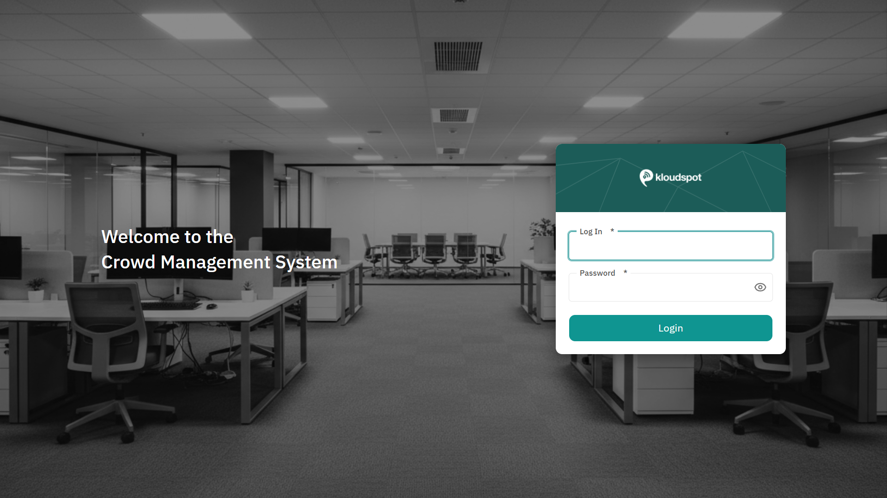
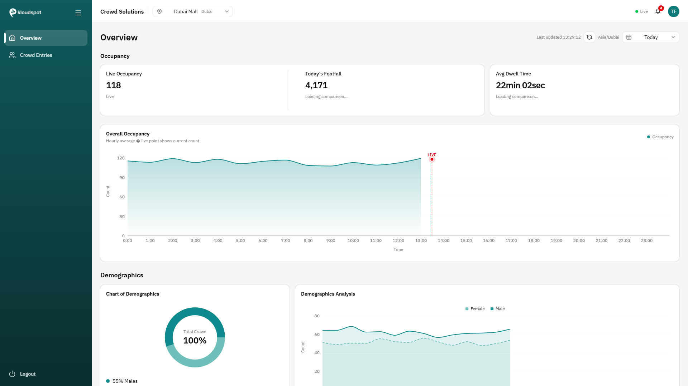
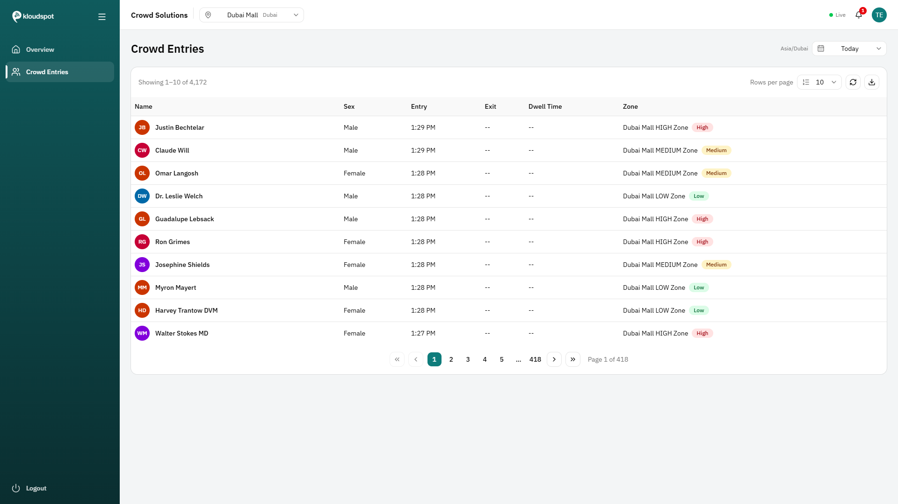
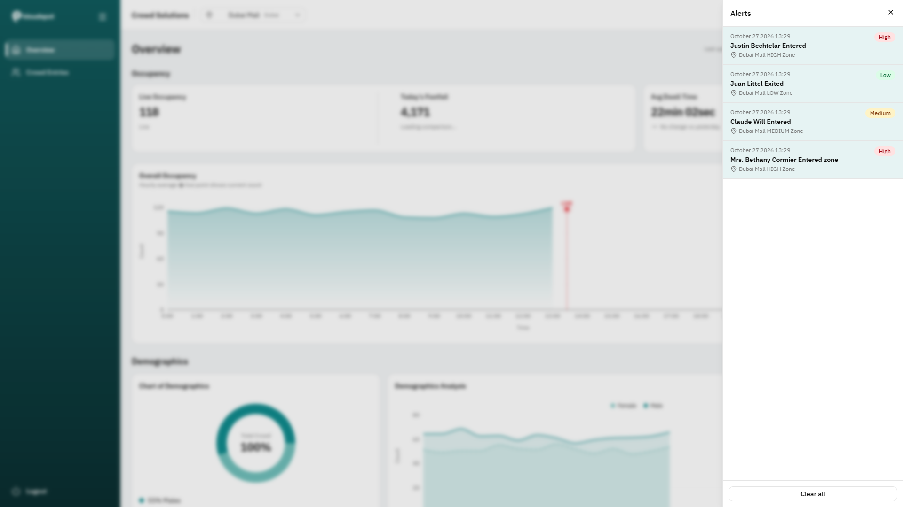

# Crowd Management System

A dashboard SPA for monitoring crowd occupancy, footfall, demographics and individual entries across sites, with a live Socket.IO layer for occupancy and alerts.

| Login | Overview |
| --- | --- |
|  |  |

| Crowd Entries | Alerts drawer |
| --- | --- |
|  |  |

**Live demo:** _not deployed yet._ `vercel.json` and `public/_redirects` are included, so a deploy to Vercel or Netlify works as-is (set `VITE_API_BASE_URL`).

## Tech stack

| Concern | Choice | Why |
| --- | --- | --- |
| UI | React 19 + TypeScript (strict) + Vite | fast dev loop, strict types catch contract drift |
| Styling | Tailwind v4 + shadcn/ui (Radix) | accessible primitives, tokens as CSS variables |
| Server state | TanStack Query | caching, de-duplication, `keepPreviousData` for pagination and filters |
| Auth state | Redux Toolkit (auth only) | one small, predictable store for the session; all server data stays in Query |
| Routing | React Router v7 | lazy routes, URL as the source of truth for filters |
| Charts | Recharts via shadcn `chart` | lazy-loaded chunk |
| Live data | socket.io-client | matches the backend |
| Validation | zod | every API response and socket payload is validated at the boundary |

## Getting started

```bash
npm install            # .npmrc sets legacy-peer-deps (peer conflict in @hookform/resolvers)
cp .env.example .env   # set VITE_API_BASE_URL (VITE_SOCKET_URL is optional)
npm run dev            # http://localhost:5173
```

Sign in with the credentials provided by the hiring team.

| Script | Purpose |
| --- | --- |
| `npm run dev` | dev server |
| `npm run build` | type-check + production build |
| `npm run preview` | serve the production build |
| `npm run lint` | ESLint |

Environment variables: `VITE_API_BASE_URL` (required), `VITE_SOCKET_URL` (optional, defaults to the API origin).

## Architecture

```
src/
  app/        providers, store, router, layout (sidebar, header, hotkeys)
  config/     routes, navigation, date presets, hotkeys (single sources)
  features/   auth | sites | filters | analytics | entries | live
              each has components/, hooks/, api/, utils/ and an index.ts barrel
  components/ shared presentational pieces + shadcn ui/
  hooks/      generic hooks (media query, online status, hotkeys, CSV export)
  lib/        http client + interceptors, query keys, date/format/csv utils
  pages/      thin route components
```

Layers: `pages` compose `features`; features use `components/shared`, `hooks` and `lib`; components never call axios, only feature `api/` modules do.

### Data flow

- **REST:** component -> feature hook (TanStack Query) -> `api/` module -> axios client -> zod-validated response -> mapper -> UI types.
- **Live:** one `socket.io` connection (`SocketProvider`, mounted only in the protected layout). Events are parsed by `socketContract.ts` (the only file that knows the wire format).
  - `live_occupancy` -> the site total is written to the query cache, throttled to one update per second. Only the Live Occupancy card and the chart's live point re-render.
  - `alert` -> Redux alerts slice (newest first, capped at 50, deduped by `eventId`), shown in the bell and drawer.
- **Auth:** login stores the JWT (Redux + `localStorage`). An axios interceptor adds `Authorization: Bearer`. A 401 on any request ends the session (store cleared, query cache cleared, redirect to login). A timer logs out at token expiry. Protected routes redirect to `/login`, and public routes redirect away when signed in. The socket is created from the token and torn down on logout.
- **URL as state:** `?site=&range=&page=&size=`. Reloading or sharing a link restores the view.

## Key decisions and trade-offs

- **Token in localStorage:** survives reloads, but is readable by any XSS. Mitigations: no `dangerouslySetInnerHTML`, validated inputs, the token is never logged, and short-lived expiry is enforced client-side. An httpOnly cookie would be better but needs backend support.
- **Redux only for auth** (and small live UI state: the alerts list). Server data is never copied into Redux.
- **Site time zone for days:** "Today" and "Yesterday" are evaluated in the selected site's IANA zone, not the browser's, so Dubai "today" is the same for everyone.
- **Server pagination:** the API paginates; the client requests one page at a time and prefetches only the next.
- **Memoisation where it matters:** hourly chart series are memoised and the live layer is separate, so socket updates do not re-render the chart or other cards. Alert list items are `memo`.
- **Intl instead of date-fns format** for display, which keeps ~20 kB out of the bundle.

## API notes

- Analytics endpoints are `POST` with `{ siteId, fromUtc, toUtc }` (epoch ms); entries add `pageNumber` (1-based) and `pageSize`.
- Latency is high: each analytics call takes ~1.5-3.5 s and calls look serial, so the Overview's six requests take up to ~15 s. Slow calls use a 40 s timeout; comparison queries start after the primary ones.
- There is no logout endpoint (`/api/auth/logout` returns 404), so logout is client-side.
- Socket: same origin as the API; auth via the handshake `auth: { token }`; no subscribe emit; events `alert` and `live_occupancy` (`sim:event` mirrors `alert` and is ignored). Observed about 70 `alert` and 50 `live_occupancy` events per minute across all sites.

## Accessibility

Skip link to `<main>`; focus moves to the page heading on route change; visible focus rings; icon-only buttons have names; data tables have captions; charts are `role="img"` with a text summary plus a screen-reader data table (including the live value); pagination uses `aria-disabled` so focus is never lost; the alerts drawer traps focus, closes on Esc and returns focus to the bell; the live announcer is throttled; severity and connection state are never colour-only; `prefers-reduced-motion` is respected. An axe-core run (WCAG 2.1 AA + best practices) on login, overview, alerts drawer, shortcuts dialog and entries found one contrast issue (login button), which is fixed. Keyboard shortcuts: `g o`, `g e`, `b`, `?`.

## Performance

- Pages, the app shell, the alerts drawer and the chart code are lazy chunks; vendor chunks (react, router, tanstack, radix, socket) are split for caching.
- The login path loads about 213 kB gzip of JS (the app shell, socket client and Recharts are not loaded there).
- Before this phase the single main chunk was 501.7 kB (159 kB gzip) with the shell eagerly included; it is now 271 kB (85 kB gzip) plus cached vendor chunks.
- The Entries route is prefetched on sidebar hover/focus.
- Lighthouse could not be run in this environment (headless Edge failed under the CLI); run `npx lighthouse http://localhost:4173 --preset=desktop` against `npm run preview` to record scores.

## Known limitations

- Dark mode is not implemented (several components use fixed colours).
- Header language chip and avatars from the Figma are not built.
- The Zone column and the "Crowd Entries" title are kept although the Figma differs slightly.
- The mobile navigation sheet can reopen after a resize across the breakpoint.
- There is no automated test suite yet.

## What I would do next

httpOnly cookie auth, an automated test suite (unit and end-to-end), a loading-progress UI for the slow analytics calls, per-zone live occupancy, Lighthouse CI, and dark mode.
